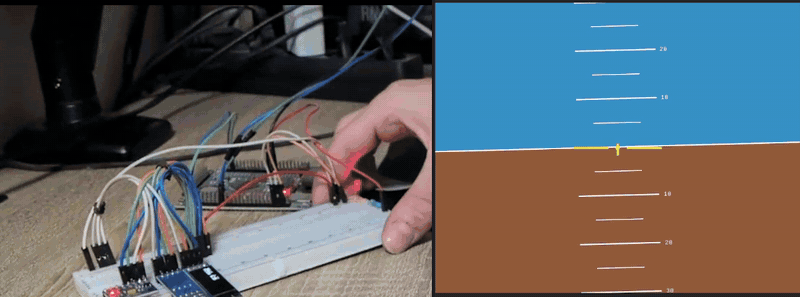
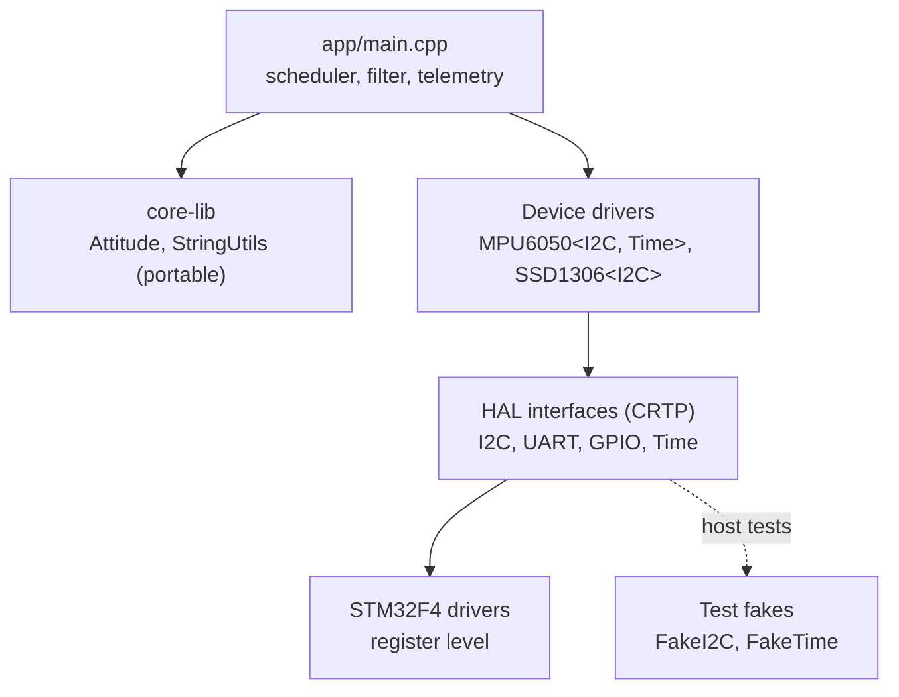

# STM32 Attitude Indicator

[](https://github.com/AdrianZamoraSanchez/stm32-attitude-indicator/actions/workflows/ci.yml)

Bare-metal C++20 firmware for an **STM32F407** that estimates roll and pitch from an **MPU6050** IMU and streams them to a PC, where a Python GUI draws an aircraft-style artificial horizon in real time.

No vendor HAL and no RTOS: register-level drivers, a zero-overhead hardware abstraction layer built with CRTP, and host unit tests that run the real driver code against a fake I2C bus.

## About this repository

This is an extract of a larger personal STM32F4 project: an embedded platform for a programmable vehicle, with drivers for more peripherals (ToF distance sensor, EEPROM, IR temperature sensor) and a work-in-progress command interface.

This repository contains only the parts behind the attitude indicator demo: the hardware abstraction layer, the STM32F4 drivers, the MPU6050 and SSD1306 drivers and the PC ground station. They were cleaned up, documented and covered by host unit tests to work as a standalone project. The hardware is the development board used for the larger project, not a dedicated build.



## Features

- **Register-level STM32F4 drivers** (GPIO, I2C, USART, SysTick/clock) written from the reference manual, without ST's HAL.
- **CRTP hardware abstraction layer**: device drivers (MPU6050, SSD1306) are templates over `HAL::I2C<Impl>`, so they never depend on the MCU and calls are resolved at compile time (no vtables).
- **Sensor fusion**: complementary filter combining gyro integration (fast, drifts) with the accelerometer gravity vector (noisy, drift free), with gyro bias calibration at boot.
- **Cooperative scheduler**: IMU at 100 Hz, telemetry at 50 Hz, OLED at 4 Hz, heartbeat LED, all from a 1 ms SysTick.
- **Host unit tests** (GoogleTest, 37 tests) for the MPU6050 driver, the attitude math and the number formatting, plus a GitHub Actions pipeline that cross-compiles the firmware and runs the tests on every push.
- **PC ground station** in Python (Dear PyGui + pyserial) with live rate monitoring and a simulation mode that works without a board.

## Hardware

| Part | Notes |
| --- | --- |
| STM32F407VET6 board | 8 MHz HSE crystal, clocked at 84 MHz from the PLL |
| MPU6050 (GY-521) | 3-axis accelerometer + gyro, I2C address 0x68 |
| SSD1306 OLED, 128x32 | I2C address 0x3C |
| USB-UART adapter (CP2102) | Telemetry link to the PC |
| ST-Link | Flashing and debugging (SWD) |

### Wiring

| Signal | MCU pin | Connected to |
| --- | --- | --- |
| I2C2 SCL | PB10 | MPU6050 SCL, SSD1306 SCL |
| I2C2 SDA | PB11 | MPU6050 SDA, SSD1306 SDA |
| USART1 TX | PA9 | USB-UART RX |
| USART1 RX | PA10 | USB-UART TX |
| Status LED | PA1 | LED + resistor to GND |
| 3V3 / GND | | All modules |

The I2C pull-ups are the ones fitted on the sensor and display modules.

## Architecture



```
firmware/
  app/            main loop and AppConfig.h (pins, rates, tuning)
  include/HAL/    hardware-independent interfaces (CRTP)
  include/driver/ STM32F4 drivers + MPU6050 and SSD1306 device drivers
  include/core-lib/ portable code: attitude estimation, formatting, types
  src/            STM32F4 driver implementations
  stm32f4xx/      CMSIS headers, startup code, linker script, CPU flags
  toolchain/      arm-none-eabi CMake toolchain file
tests/            host unit tests (GoogleTest) and fakes
tools/gui/        Python ground station
docs/             debugging notes, media
```

## Design notes

**Why CRTP.** `HAL::I2C<Impl>` forwards each call to `Impl` through a `static_cast`, so the compiler inlines straight into the register code. Device drivers take the interface as a template parameter: the same `MPU6050` code runs on the STM32 and, in the tests, against `FakeI2C`, which emulates the chip's register file.

**Sensor fusion.** The accelerometer gives absolute roll and pitch from gravity, but any vibration reads as tilt. The gyro is smooth but its integral drifts. The complementary filter integrates the gyro and pulls the result towards the accelerometer:

```
angle = alpha * (angle + rate * dt) + (1 - alpha) * accel_angle
```

With `alpha = 0.98` at 100 Hz the time constant is about 0.5 s. Body rates are converted to Euler angle rates before integrating, and roll is blended along the shortest angular difference so it does not jump at +/-180 degrees. `FILTER_ALPHA = 0` in `AppConfig.h` gives accelerometer-only behavior for comparison.

**Mount compensation.** The sensor board is mounted rotated with respect to the vehicle, so `AppConfig.h` maps sensor roll/pitch to vehicle roll/pitch (`SENSOR_MOUNT`) in one documented place, instead of sign flips scattered through the code.

**Timing budget.** A full OLED frame is 513 bytes, about 46 ms at 100 kHz I2C, so the display refreshes at 4 Hz and never blocks the 100 Hz IMU loop for long. The filter uses the measured `dt`, so an occasional late sample does not distort the estimate. Telemetry at 50 Hz uses under 10% of the 115200 baud link.

**FPU enable.** The firmware is built with `-mfloat-abi=hard`, so the FPU is enabled in `SystemInit()`, before static constructors run. Enabling it in `main()` would fault on any floating point instruction executed earlier.

## Build

Requirements: CMake 3.20+, `arm-none-eabi-gcc` (tested with 13.2.1).

```bash
cd firmware
cmake -B build -S . -DCMAKE_TOOLCHAIN_FILE=toolchain/arm-none-eabi.cmake
cmake --build build
```

Outputs `build/app/attitude_indicator.elf` and `.bin`. Use `-DCMAKE_BUILD_TYPE=Release` for an optimized build (about 13 KB of flash).

## Flash and debug

With OpenOCD and an ST-Link:

```bash
openocd -f interface/stlink.cfg -f target/stm32f4x.cfg \
  -c "program firmware/build/app/attitude_indicator.elf verify reset exit"
```

GDB over OpenOCD, including a WSL2 setup, is described in [docs/debugging.md](docs/debugging.md).

At boot the LED stays on for about a second while the gyro bias is calibrated: **keep the board still**. After that the LED blinks at 1 Hz. A fast blink means the IMU or the display did not answer on the I2C bus.

## Ground station

```bash
cd tools/gui
pip install -r requirements.txt
python attitude_gui.py
```

Pick the serial port, press **Connect** and tilt the board. Without a board, the sliders drive the horizon.

Telemetry protocol, one ASCII line per sample at 50 Hz:

```
ATT,<roll>,<pitch>\n      degrees, two decimals, vehicle frame
```

## Tests

```bash
cd tests
cmake -B build -S .
cmake --build build
ctest --test-dir build --output-on-failure
```

The tests cover the MPU6050 driver (init sequence, device detection, big-endian decoding, bias calibration and saturation), the attitude estimation (accelerometer angles, filter convergence, gyro tracking, spike rejection, wrap-around) and the number formatting used for telemetry.

## Known limitations

- Polling drivers only: no interrupts or DMA for I2C/UART, so OLED updates block the CPU for their duration.
- Single I2C peripheral (I2C2) and USART1 hard-wired in the drivers.
- No yaw: the MPU6050 has no magnetometer, so heading would drift.
- The complementary filter assumes small accelerations. Sustained acceleration (a turning vehicle) biases the estimate; a Kalman filter or acceleration-aware gain would be the next step.

## License

MIT, see [LICENSE](LICENSE). The CMSIS headers in `firmware/stm32f4xx/inc` (Arm and STMicroelectronics, Apache-2.0), and the startup file and linker script (generated by STM32CubeIDE) keep their original licenses.
